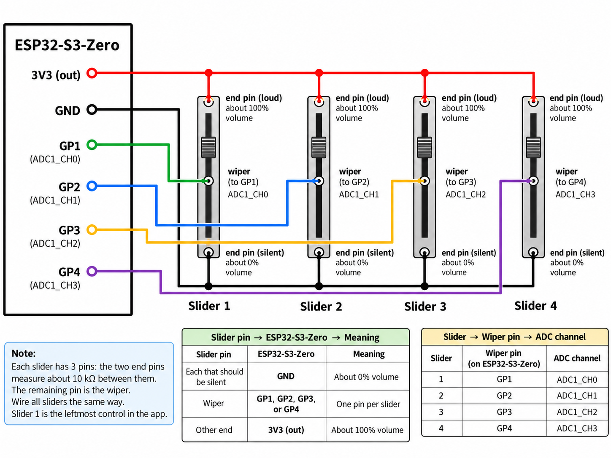
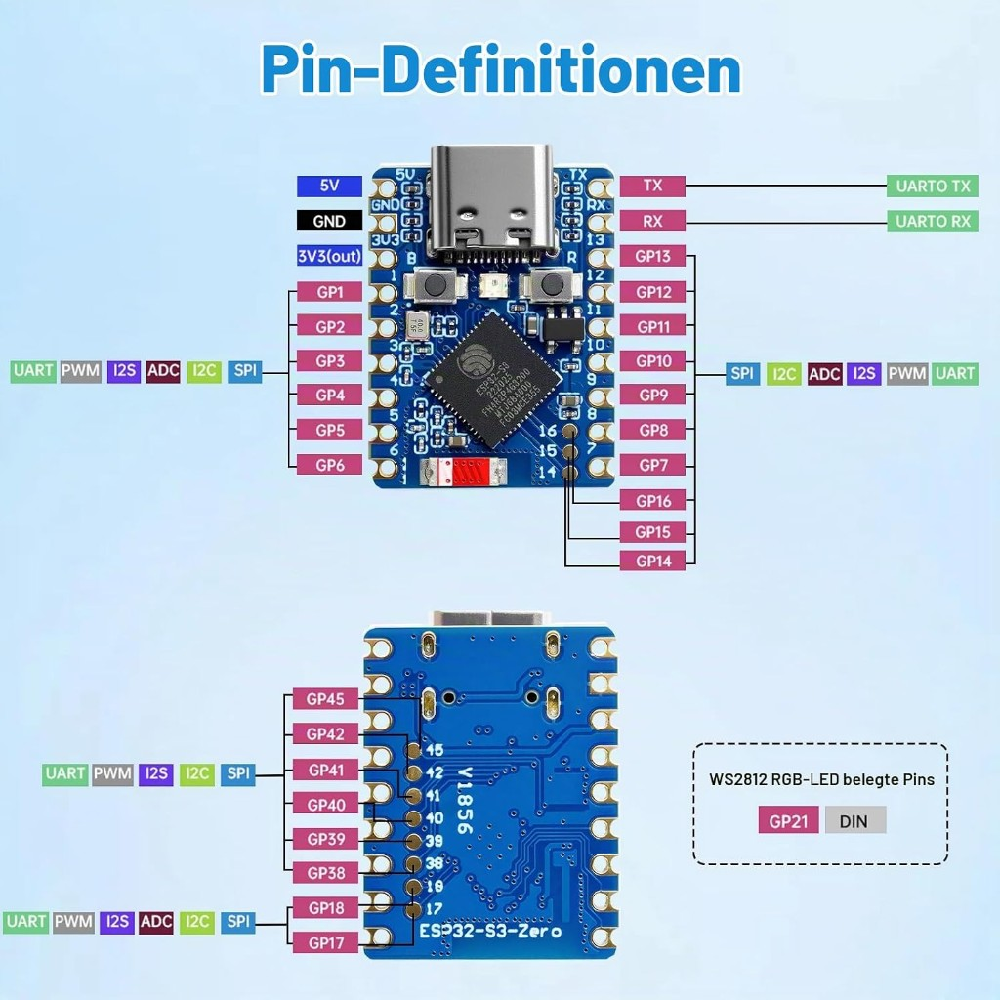

# SoundMixer

A USB volume mixer for Windows. Four slide potentiometers on an [ESP32-S3-Zero](https://www.waveshare.com/wiki/ESP32-S3-Zero) set the master volume of playback devices (speakers, headphones, HDMI, and so on). A small tray app applies those positions. It does not change the volume of individual programs.

The app runs on Windows 10 and Windows 11. The board talks to the PC over the same USB-C cable used for programming. There is no separate USB-serial chip and no Wi-Fi.

```text
slide pots  →  ESP32-S3-Zero  →  USB serial  →  tray app  →  Windows playback devices
```

## Hardware

### Parts

| Qty | Part | Notes |
| --- | --- | --- |
| 1 | [ESP32-S3-Zero](https://amzn.eu/d/0aSRMNqI) | ESP32-S3FH4R2, 4 MB flash, native USB-C. The linked board is a Heemol ESP32-S3 Mini with this pinout. |
| 4 | [Slide potentiometer, 10 kΩ linear (B10K)](https://amzn.eu/d/0g2a3Muu) | 75 mm length, 60mm travel. The linked pack is a dual-gang B103; use one gang (three pins) per slider. Linear (B), not audio taper (A). |
| 1 | USB-C cable | Must carry data. Charge-only cables never show a COM port. |
| | Wire | One shared ground, one shared 3.3 V, one wiper wire per slider. |

A multimeter is enough to find the wiper if the pot has no pin numbers. Optional: prototype board, enclosure, knob caps.

Do not substitute a 5 V board pin for the pot supply. The ESP32-S3 ADC pins are not 5 V tolerant.

### Wiring



Each slider has three pins. Find them with a meter if they are not marked:

- The two end pins read about 10 kΩ between them, and that reading stays put while you move the slider.
- The wiper is the remaining pin. Resistance from the wiper to either end changes as the slider moves.

Connect every slider the same way. Slider 1 is the leftmost control in the app. The end that should be silent goes to GND (about 0 % volume). The other end goes to 3V3 (out) (about 100 % volume).

| Slider | Wiper pin | ADC channel |
| --- | --- | --- |
| 1 | GP1 | ADC1_CH0 |
| 2 | GP2 | ADC1_CH1 |
| 3 | GP3 | ADC1_CH2 |
| 4 | GP4 | ADC1_CH3 |

All four pots share the single GND pin and the single 3V3 pin on the board. Together they draw about 1.3 mA.

If one slider works backwards, swap only the GND and 3V3 wires on that slider. Leave the wiper where it is. The app can also flip all four at once (see [Settings window](#settings-window)).

Leave these pins unconnected:

- GPIO0, the BOOT button
- GPIO19 and GPIO20, the USB data pins
- GPIO21, the onboard RGB LED

GP3 is a strapping pin. It is sampled while the chip resets, and a high level there can stop a flash from starting. Before you flash, slide control 3 all the way to the GND end.

The ADC, at 11 dB attenuation, reaches full scale around 3.1 V. A pot tied to 3.3 V therefore sits a little short of the top code. The firmware filters the reading, and the app treats a small band at each end as 0 % and 100 %, so both stops are still reachable.

### Pinout

USB-C is at the top of the front view. GP1 through GP4, GND, and 3V3 are on the left side of that view.



Front, left row, top to bottom. Slider 1 is GP1 through slider 4 on GP4; the wiring table above is the full mapping.

| Pin | Use |
| --- | --- |
| 5V | Leave open. Do not feed the sliders from here. |
| GND | Silent end of every slider |
| 3V3 (out) | Loud end of every slider |
| GP1–GP4 | One wiper each |
| GP5, GP6 | Free |

The two onboard buttons are BOOT (marked B, wired to GPIO0) and RESET (marked R).

## Software

### Tools

Install these on the Windows PC that will run the mixer:

- [Go 1.26](https://go.dev/dl/) or newer. `go version` should print `go1.26` or higher.
- [PlatformIO](https://platformio.org/install/cli/) (`pio` on the PATH), or the PlatformIO extension in VS Code. The extension install still provides the `pio` command inside its environment.
- This repository: `git clone https://github.com/SchmidtJu/SoundMixer.git`

The first PlatformIO build downloads the ESP32 toolchain and needs an internet connection. The first `go build` downloads the Go modules the same way.

Windows 10 and 11 already include the USB driver for this board. It shows up as a COM port with USB vendor ID `303A` (Espressif), often named “USB Serial Device” or “USB JTAG/serial debug unit”. A CH340 or CP210x driver is not used.

### Flash the firmware

1. Quit the tray app if it is already running. Right-click the icon and choose **Quit**. While the app holds the COM port, esptool reports access denied.
2. Slide control 3 to the silent (GND) end.
3. Plug the board in with a data USB-C cable.
4. Open a terminal in the `firmware` folder.

Build and find the port. The first build can take several minutes.

```text
pio run
pio device list
```

If `pio` is not on the PATH, use `python -m platformio` in place of `pio` for every command below.

Note the COM port of the device whose vendor ID is `303A`. The steps below call it `COM5`; use the port from the list.

`pio run -t upload` is unreliable on this board. The ESP32-S3-Zero uses native USB, and the 1200-baud “touch” that PlatformIO sends does not always enter the bootloader. The port can stay busy afterwards. Flash with esptool and a normal reset instead.

PowerShell, from the `firmware` folder:

```powershell
pio pkg exec -p tool-esptoolpy -- esptool.py --chip esp32s3 --port COM5 --baud 921600 --before default_reset --after hard_reset write_flash --flash_mode dio --flash_freq 80m --flash_size 4MB 0x0 .pio/build/esp32-s3-zero/bootloader.bin 0x8000 .pio/build/esp32-s3-zero/partitions.bin 0xe000 "$env:USERPROFILE/.platformio/packages/framework-arduinoespressif32/tools/partitions/boot_app0.bin" 0x10000 .pio/build/esp32-s3-zero/firmware.bin
```

Command Prompt is the same command with `%USERPROFILE%` instead of `$env:USERPROFILE`.

If that connect attempt fails, put the chip into the bootloader by hand and flash before it leaves that mode:

1. Hold BOOT (B).
2. Tap RESET (R).
3. Release BOOT.
4. Run the same esptool command with `--before no_reset` in place of `--before default_reset`.

### Check the serial link

With the tray app still closed:

```text
pio device monitor
```

Exit the monitor with Ctrl+C. Two kinds of lines are normal:

- `gpio 1=2048 2=10 3=4000 4=100` about twice a second. These are raw ADC counts from 0 to 4095.
- `1023|640|0|210` about once a second, and again whenever a slider moves. These are the four slider values, 0 to 1023, in slider order (`slider1|slider2|slider3|slider4`). This is the line the app reads.

The firmware filters each ADC reading before it sends that line. The app maps 0–1023 onto the master volume of the assigned playback endpoint.

Move each slider from end to end. The matching number should travel from near 0 to near 1023. A value stuck at either extreme usually means that wiper is tied to GND or 3V3, or is not connected.

### Build the Windows app

The app builds only on Windows. From the `client` folder:

```text
go build -ldflags "-H windowsgui -s -w" -o soundmixer.exe ./cmd/soundmixer
```

`-H windowsgui` starts the program without a console window. `client/cmd/soundmixer/rsrc.syso` is the Windows manifest and has to stay next to `main.go`. Without it, the window controls do not come up.

Start it:

```text
.\soundmixer.exe
```

The icon appears in the notification area (the system tray). If you do not see it, open the overflow arrow next to the clock. A second start does nothing useful: Windows shows **SoundMixer is already running.** and that process exits. Quit the running copy from the tray menu before starting another build.

For a console while you are changing the code:

```text
go run ./cmd/soundmixer
```

## Use

### Settings window

Left-click the tray icon, or choose **Settings…** from the menu. **Quit** closes the app.

Assign each slider in the settings window, then click **Save**:

- Pick a playback device, **Unassigned**, or **Windows default device**.
- **Unassigned** means that slider does nothing.
- One device can belong to only one slider. Saving a duplicate shows a warning and keeps the previous settings.
- **Windows default device** follows whatever Windows currently uses as the default playback device.
- An unplugged device stays in the list with **(disconnected)** and works again when it comes back.
- **Invert sliders** swaps the quiet and loud ends of all four sliders.
- **Start with Windows** starts the app when you sign in. After you move the exe, open settings and save once so the startup path is updated.
- **Enable logging** writes a log file. The path and the size limit are in [Configuration file](#configuration-file).
- The status line shows **Connected (COM5)** or **Disconnected – looking for ESP32…**.

While a slider sits still, the keyboard volume keys and the Windows volume slider keep working. The next movement of that hardware slider sets the volume again.

### Configuration file

Settings are stored in `%AppData%\SoundMixer\config.json`. The folder is created the first time the app runs. A new file looks like this:

```json
{
  "com_port": "auto",
  "last_port": "",
  "invert_sliders": false,
  "autostart": false,
  "logging": true,
  "sliders": [
    { "device_id": "", "device_name": "" },
    { "device_id": "", "device_name": "" },
    { "device_id": "", "device_name": "" },
    { "device_id": "", "device_name": "" }
  ]
}
```

`com_port` is `auto`, which selects the USB device with vendor ID `303A`. Set it to a fixed name such as `COM5` if another Espressif board is also plugged in. `last_port` is filled in by the app and is the fallback when the vendor search finds nothing.

`device_id` is the Windows endpoint id. Leave both fields empty for an unassigned slider. `system.default` is the Windows default device. You can edit the file while the app is closed. With the app open, use the settings window so the running mixer picks up the change.

**Start with Windows** adds or removes a `SoundMixer` value under `HKCU\Software\Microsoft\Windows\CurrentVersion\Run`. It points at the exe you are running. This is a per-user startup entry, not a Windows service, because audio belongs to the signed-in session.

Logging is on unless you clear **Enable logging**. The file is `%AppData%\SoundMixer\soundmixer.log` and stays within 5 MB; older lines are dropped. With the box cleared, the app stops adding lines. The file is the place to look when the tray build has no console.

## Troubleshooting

| What you see | What to do |
| --- | --- |
| No COM port | Use a data USB-C cable. Try another port. In Device Manager, look for a device with VID `303A`. |
| esptool: access denied, or the port is busy | Quit the tray app (**Quit**) and close `pio device monitor`. |
| esptool cannot connect | Slider 3 at the GND end. Then the manual BOOT + RESET sequence and `--before no_reset`. |
| Monitor prints `gpio` lines but the numbers never change | Wiper not on GP1–GP4, or a bad joint. The end-to-end resistance of the pot should stay near 10 kΩ. |
| A number stays near 0 or near 1023 | That end is tied to the wrong rail, or the wiper is shorted to an end pin. |
| Tray icon missing | Check the notification overflow (^). Confirm `rsrc.syso` was beside `main.go` when you built. |
| “SoundMixer is already running.” | The app is already in the tray. Quit it with **Quit**, then start the new exe. |
| Status stays “Disconnected – looking for ESP32…” | Board unplugged, cable is charge-only, or firmware was not flashed. `com_port` in the config may also name a port that is not present. |
| “COMx is busy or not ready” | Another program has the port (serial monitor, a second copy, a flashing tool). |
| Slider moves, Windows volume does not | That slider is still **Unassigned**, or it is assigned to a device that is **(disconnected)**. |
| Top or bottom of the travel feels flat | Expected. A small dead zone at each end makes 0 % and 100 % reliable. |
| Volume jumps the wrong way | Swap GND and 3V3 on that one slider, or enable **Invert sliders** for all four. |

## Repository

| Path | Contents |
| --- | --- |
| `firmware/` | PlatformIO project. Firmware source is `firmware/src/main.cpp`. |
| `client/` | Go module. Entry point is `client/cmd/soundmixer`. |
| `docs/wiring.png` | Wiring diagram used above. |
| `docs/esp32-s3-zero-pinout.jpg` | Pinout drawing used above. |
